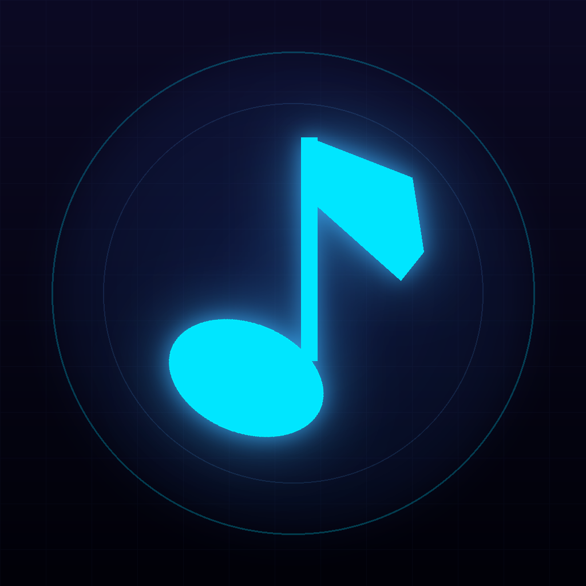
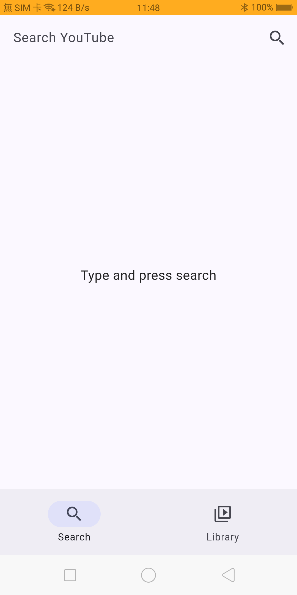
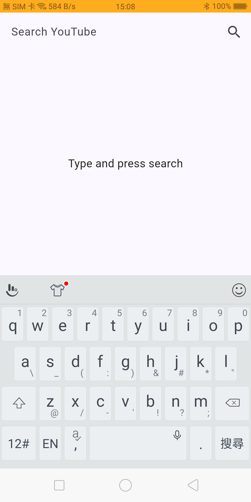
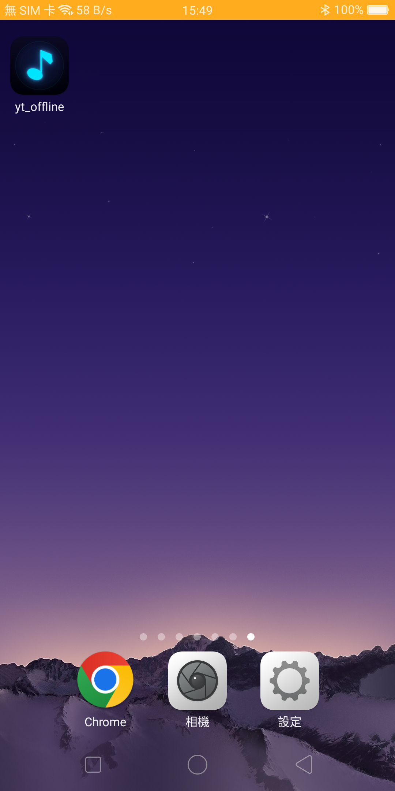

# yt_offline

<p align="center">
  
</p>

<p align="center">
  <strong>專為離線情境打造的 YouTube 影音下載與智慧播放器</strong><br>
  支援外掛字幕、背景鎖屏播放、A-B 段落循環、分類拖曳管理與手勢操作
</p>

<p align="center">
  
  
  
  
  
  
</p>

---

## 📱 使用畫面 (Screenshots)

| 搜尋主畫面 | 關鍵字輸入搜尋 | 桌面 App 圖示 |
| :---: | :---: | :---: |
|  |  |  |
| 清爽直覺的 Material 3 搜尋介面 | 支援即時建議與搜尋歷史記錄 | 專屬設計的高質感 Neon 音符圖示 |

---

## 💡 專案簡介

**yt_offline** 是一款以 Flutter 開發的跨平台行動應用程式。專為通勤族、語言學習者、音樂愛好者以及常在無網路或弱網環境（如搭乘飛機、高鐵）的使用者所設計。

透過本應用程式，您可以輕鬆搜尋 YouTube 內容、下載影片與對應字幕，並在離線環境下享有如專業影音播放器般的順暢體驗。

---

## ✨ 核心功能特色

### 🔍 智慧搜尋與外部分享
* **無縫瀏覽**：支援關鍵字搜尋與無限滾動分頁載入。
* **進階篩選**：可依照相關度、上傳日期、觀看次數或影片時長進行精確篩選。
* **搜尋記錄**：自動記錄熱門搜尋詞，支援模糊比對與單筆/全域清除。
* **外部分享導入**：可直接從 YouTube 或其他瀏覽器將影片連結分享至本 App 快速解析。

### ⚡ 穩定下載與字幕整合
* **背景斷點續傳**：採用高效背景下載機制，支援暫停、繼續、取消與失敗重試。
* **字幕自動提取**：下載影片時自動擷取中/英字幕，儲存為獨立 `.srt` 檔案，離線時可任意切換。
* **防重複機制**：點擊已下載影片時主動提醒，避免耗費流量與儲存空間。

### 📂 媒體庫與分類管理
* **自訂分類**：建立個人專屬類別（如「聽力練習」、「音樂」、「教學影片」），可折疊收合。
* **直覺拖曳排序**：
  * 長按卡片可自由調整同一分類內的播放順序。
  * 將卡片直接拖放至分類標題，即可快速跨分類移動。
* **批次管理與滑動操作**：支援長按多選批次移動，以及向左滑動快速刪除。
* **動態指示**：正在播放的影片卡片上會呈現活潑的等化器跳動效果。

### 🎧 極致影音播放體驗
* **背景純音訊播放**：支援鎖定螢幕與切換應用程式持續播放，無縫聆聽不中斷。
* **系統級媒體控制**：整合系統通知列、鎖屏控制器、耳機線控按鍵操作。
* **全域迷你播放列 (Mini Player)**：切換到任何頁面都能保持底層播放與快速切換控制。
* **A-B 段落循環**：自由設定 A、B 兩點，重複循環精華片段（語言學習、樂器抓歌必備）。
* **全螢幕橫向手勢控制**：
  * 左半部垂直滑動：調節螢幕亮度
  * 右半部垂直滑動：調節音量大小
  * 水平滑動：精準快轉 / 倒轉進度
* **畫中畫模式 (PiP)**：一邊觀看影片，一邊回覆訊息或操作其他軟體。
* **客製化外掛字幕**：隨時開啟/關閉字幕，並可自訂字型大小、顏色與背景透明度。
* **進階控制**：支援 0.5x ~ 2.0x 播放速度調節與睡眠定時關閉 (Sleep Timer)。

### ⚙️ 系統設定與空間管理
* **觀看歷史 (Watch History)**：記錄近期的觀看軌跡，隨時接續收看。
* **儲存空間分析**：直觀顯示已下載影音佔用的容量，並提供一鍵清理已觀看項目的智慧維護。

---

## 🏗️ 架構與技術棧

本專案嚴格遵循 **Clean Architecture（簡潔架構）** 原則，搭配 **Feature-First** 目錄結構，確保各模組高內聚、低耦合且易於擴展。

```
lib/
├── core/                       # 全域共享基礎建設 (Router, Storage, Theme, Errors)
└── features/
    ├── search/                 # 搜尋模組 (Data / Domain / Presentation)
    ├── download/               # 下載管理模組 (背景傳輸隊列、字幕提取)
    ├── library/                # 媒體庫模組 (分類管理、拖曳排序、空間管理)
    ├── player/                 # 播放器模組 (MediaKit、背景音訊服務、手勢控制)
    └── settings/               # 設定模組 (字幕樣式、觀看歷史、儲存清理)
```

### 主要技術選型

| 領域 | 使用套件 / 技術 | 說明 |
|---|---|---|
| **核心框架** | Flutter 3.41+ / Dart 3.11+ | 跨平台原生渲染體驗 |
| **狀態管理** | `flutter_riverpod` (2.6) | 聲明式狀態管理與依賴注入，無代碼生成器相依 |
| **頁面路由** | `go_router` (14.x) | 宣告式路由與 `StatefulShellRoute` 保持導覽狀態 |
| **影音核心** | `media_kit` (MPV 核心) | 高效硬體解碼與多軌字幕掛載 |
| **背景傳輸** | `background_downloader` | 可靠的背景隊列斷點續傳 |
| **系統媒體服務** | `audio_service` | 整合系統鎖屏控制器與背景持久執行 |
| **手勢與硬體** | `screen_brightness`, `flutter_volume_controller` | 原生級橫向亮度與音量平滑調整 |

---

## 🚀 快速開始

### 環境需求
* [Flutter SDK](https://docs.flutter.dev/get-started/install) 3.41.x 或相容版本
* [Android Studio](https://developer.android.com/studio) / Xcode（若需建置 iOS）
* Android 實機或模擬器（建議 Android 7.0 / API 24 以上）

### 安裝與啟動

1. **複製專案庫**
   ```bash
   git clone https://github.com/keywei/yt_offline.git
   cd yt_offline
   ```

2. **安裝專案依賴**
   ```bash
   flutter pub get
   ```

3. **靜態程式碼檢查**
   ```bash
   flutter analyze
   ```

4. **連接裝置並啟動**
   ```bash
   flutter run
   ```

### 建置安裝檔 (Android APK)
```bash
flutter build apk --release
```
建置完成後，APK 將輸出於 `build/app/outputs/flutter-apk/app-release.apk`。

---

## ⚠️ 免責聲明 (Disclaimer)

* 本專案僅供個人學習、研究與軟體架構交流使用。
* 軟體中影音內容之所有權與智慧財產權皆歸原創作者與 YouTube (Google LLC) 所有。
* 請勿將本應用程式用於任何商業用途或侵犯他人版權之行為。
